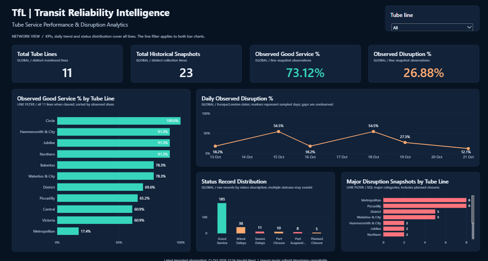
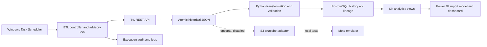

# Transit Reliability Intelligence

A local data engineering and analytics project that turns Transport for London Tube status samples into traceable historical observations and a Power BI operational dashboard.

Python extracts the TfL API, preserves JSON snapshots, validates transformed records, and loads PostgreSQL transactionally. SQL separates raw status records from line-and-time observations so simultaneous statuses do not inflate reliability KPIs. An optional Boto3 adapter adds immutable, checksum-verified S3 archival, tested entirely with Moto.

**Decision supported:** identify lines and sampled days that warrant a closer operational review, with a defensible line/time denominator.

**Explore the evidence:** [Python pipeline](src/) · [SQL analytics](sql/) · [editable Power BI project](powerbi/Transit_Reliability_Intelligence.pbip) · [KPI definitions](docs/kpi_definitions.md) · [recorded verification](docs/testing.md)



*Static preview of the completed Power BI dashboard. Figures reflect the data imported when the screenshot was captured.*

**Published on GitHub:** [Transit Reliability Intelligence](https://github.com/jatothnithinsai-tech/Transit_Reliability_Intelligence).

## Dashboard overview

The completed Power BI report brings network coverage, sampled service performance and disruption patterns into one operational view. It contains four KPI cards, four charts, a Tube Line slicer and explanatory context.

- **KPI cards:** Total Tube Lines counts distinct monitored lines; Total Historical Snapshots counts distinct collection timestamps. Observed Good Service % measures line/time observations where every status is Good Service, while Observed Disruption % measures observations with any non-Good-Service status. Each line/time pair counts once, even when it contains multiple statuses.
- **Tube Line Reliability:** The Observed Good Service % by Tube Line bar chart compares sampled reliability across the 11 Tube lines, helping identify lines with lower observed service performance.
- **Disruption trends:** Daily Observed Disruption % shows the share of disrupted line/time observations on each Europe/London calendar day. Markers represent sampled days; gaps are unobserved periods.
- **Status distribution:** Status Record Distribution shows raw record counts by service-status description. Multiple statuses can coexist within one observation, so these counts use a different denominator from the reliability KPIs.
- **Major disruptions:** Major Disruption Snapshots by Tube Line compares distinct line/time observations containing Severe Delays, Part Closure, Part Suspended or Planned Closure. These counts represent sampled observations, rather than unique incidents or disruption duration.
- **Interactive filtering:** The Tube Line slicer filters the reliability and major-disruption bar charts. All four KPI cards, the daily trend and the status distribution retain their global network scope. Clear the selection to compare all lines again.

The screenshot above is a static portfolio preview. Open [Transit_Reliability_Intelligence.pbip](powerbi/Transit_Reliability_Intelligence.pbip) in Power BI Desktop to explore the interactive report and refresh it against your local database. The report and semantic model source are included in this repository.

## Optional AWS extension

**AWS ingestion status: DEPLOYED IN STOCKHOLM (`eu-north-1`) ON 26 OCTOBER 2026.** See the [live deployment runbook](docs/aws_stockholm_deployment.md) for verified results, costs and remaining work. The original local configuration remains cloud-disabled by default.

**Local setup:** No AWS account login, real credentials, paid resources, or Free Tier benefits are required for the local project. Cloud archival is disabled by default.

The implemented cloud extension defines **EventBridge Scheduler → Lambda → TfL → private S3**, with a shared HTTP client, S3 execution leases, checksum verification, scoped IAM, failure queues and CloudWatch freshness monitoring. The deployed Lambda was manually verified against TfL and S3, including checksum and duplicate-replay checks. Automatic Scheduler delivery was verified with a temporary one-minute interval, then the enabled hourly schedule was restored. The notification subscription remains to be configured. Historical mock-only reviews below retain their original scope. See [AWS readiness](docs/aws_readiness.md), [architecture](docs/aws_architecture.md), [deployment proposal](docs/aws_deployment_plan.md), [environment](docs/aws_environment.md), [operations](docs/aws_operations.md), [London cost estimate](docs/aws_costs.md), and [local download/integration](docs/aws_local_integration.md).

## Business questions and KPIs

Business questions this project answers:

- Which of the 11 Tube lines most often reported disruption in our samples?
- How do sampled disruption percentages change by London calendar day?
- Which service-status categories occur most frequently?
- Which lines have the most observations containing our defined major categories?

These are sampled observation metrics, not actual TfL uptime, passenger delay, or incident-duration estimates.

| Business KPI | Definition |
|---|---|
| Sampled Good Service % | Line/time observations where every status is Good Service / all line/time observations × 100 |
| Sampled disruption % | Line/time observations with any non-Good-Service status / all line/time observations × 100 |
| Daily disruption % | Disrupted line/time observations / all observations for each London calendar day × 100 |
| Major disruptions by line | Distinct line/time observations with Severe Delays, Part Closure, Part Suspended or Planned Closure |
| Coverage | Distinct Tube lines and collection timestamps; the expected network contains 11 lines |

Simultaneous statuses count once per line/time observation. See [KPI definitions](docs/kpi_definitions.md) for scope, overlapping categories and interpretation.

## Architecture and tools



| Layer | Tools and source |
|---|---|
| Extraction, validation and loading | Python 3.13, Requests, pandas, psycopg2; `src/` |
| Storage and analytics | PostgreSQL 18, SQL views; `sql/` |
| Reporting | Power BI Desktop, PBIP/PBIR, TMDL, DAX; `powerbi/` |
| Local operations | Windows Task Scheduler, PostgreSQL advisory locks, execution audit |
| Optional cloud extension | Boto3, Terraform, EventBridge Scheduler, Lambda, S3, IAM, SQS, SNS, CloudWatch; `infra/aws/` |
| Verification | unittest, Moto, Responses, JSON Schema, Terraform mock provider; `tests/`, `scripts/`, `docs/validation/` |

## Verification

Publication checks rerun on 22 October 2026; earlier live checks are retained as historical evidence:

| Check | Result |
|---|---|
| Automated suite | 99 passed; 0 failures, 0 errors, 0 skipped; external sockets forbidden |
| Live local ETL (earlier verification) | TfL extraction, validation, PostgreSQL load and monitoring passed |
| Database audit (earlier verification) | 11 lines; observation keys, daily totals, major union, and loaded raw lineage reconciled |
| Power BI | PBIR checks passed for 14 visuals; 12 TMDL tables and 17 measures parsed; earlier live DAX evidence retained |
| Terraform | 1.13.5 formatting/schema validation and 3 mocked plan tests passed; no account-backed plan/apply |
| Lambda ZIP | Built locally; imports independently of the virtual environment |
| Publication review | Candidate and staged-blob scans passed; repository published on GitHub |

See the [publication review](docs/publication_review.md), [testing evidence](docs/testing.md), [earlier local verification](docs/local_verification.md), and [completion report](docs/completion_report.md) for scope and limitations. Database and imported dashboard counts can differ until Power BI refreshes.

The linked review records retain their original review dates; the current GitHub publication status is recorded below.

## Local setup

Local setup uses Python 3.13, PostgreSQL 18, and Power BI Desktop on Windows. Run these commands from the repository root:

```powershell
python -m venv .venv
.\.venv\Scripts\python.exe -m pip install -r requirements-dev.txt
Copy-Item .env.example .env   # New setup only: do not overwrite your existing .env
```

Set your local database settings in the ignored `.env`. A TfL key is optional. Keep `S3_ENABLED=false` and `S3_ALLOW_AWS=false` for normal local operation.

For a **new, empty database only**, create a database named `transit_reliability_intelligence` and set its timezone to `Europe/London`. Use psql or pgAdmin to execute these files in order:

1. `sql/00_schema_reference.sql` (PostgreSQL 18 schema export; no historical data).
2. `sql/01_create_analytics_views.sql`.
3. `sql/views/04_disruption_severity.sql`.
4. `sql/views/05_major_disruptions_by_line.sql`.
5. `sql/views/06_operational_kpi_summary.sql`.

The schema reference is for fresh installations; it has not been restored into a second database during this audit. Never run it over an existing installation. Historical JSON files and the database are intentionally excluded from Git; this repository does not distribute the existing history.

```powershell
# Fully isolated tests: no database, TfL, AWS account, Docker or LocalStack needed
.\.venv\Scripts\python.exe scripts/run_checks.py

# Normal live pipeline: calls TfL and writes to your LOCAL PostgreSQL database
.\.venv\Scripts\python.exe src/pipeline/run_pipeline.py

# Read-only database and historical-source reconciliation
.\.venv\Scripts\python.exe scripts/audit_project.py

# Offline dashboard definition checks
.\.venv\Scripts\python.exe powerbi/tools/validate_dashboard.py

# Publication candidates and known-secret checks; never prints secret values
.\.venv\Scripts\python.exe scripts/security_review.py
```

Open the PBIP in Desktop and refresh using your local PostgreSQL credentials through Power BI's credential dialog. Credentials are not embedded in TMDL. The supplied model targets `localhost:5432` and the project database. The preservation validator uses ignored local backups/caches and is specific to the original workstation; a fresh clone needs the model parser or Desktop for model verification.

The existing Windows task runs the virtual environment's Python against `src/pipeline/run_pipeline.py` from this project root, hourly, with missed-start recovery. PostgreSQL advisory locks also prevent concurrent controller runs. Sleep, shutdown, and manual invocation of individual stage scripts can still leave sampling gaps. See [operations](docs/architecture.md).

Storage and future cloud setup are covered in [the AWS deployment plan](docs/aws_deployment_plan.md). The Lambda artifact archives raw data only; it does not connect to a laptop database or refresh Power BI. LocalStack and Docker are optional and were not used.

## Documentation

- [Architecture and operations](docs/architecture.md)
- [Data dictionary](docs/data_dictionary.md)
- [KPI definitions and interpretation](docs/kpi_definitions.md)
- [Testing and verification](docs/testing.md)
- [Historical publication review](docs/publication_review.md)
- [AWS architecture, deployment and rollback](docs/aws_deployment_plan.md)
- [Free AWS Educate practice](docs/aws_educate_guide.md)
- [Interview walkthrough](docs/interview_walkthrough.md)

## GitHub publication

This project is already published at [jatothnithinsai-tech/Transit_Reliability_Intelligence](https://github.com/jatothnithinsai-tech/Transit_Reliability_Intelligence) on the `master` branch. The repository includes the Python ETL pipeline, PostgreSQL analytics, Power BI report and semantic model source, dashboard screenshot and technical documentation.

To work with a local copy:

```powershell
git clone https://github.com/jatothnithinsai-tech/Transit_Reliability_Intelligence.git
cd Transit_Reliability_Intelligence
```

Local data, `.env`, credentials, logs, virtual environments, binary Power BI files, caches, backups, Terraform inputs/state/plans, and deployment ZIPs remain excluded. The `.env.example`, Terraform variable example and provider lock file are safe templates/metadata and are included. A real AWS deployment requires separate approval and is unrelated to GitHub publication.
