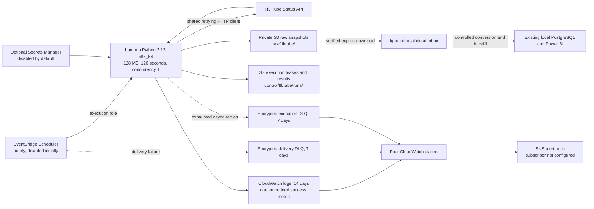

# AWS ingestion architecture — NOT DEPLOYED

Prepared and checked locally on 22 October 2026. This is a raw-data ingestion extension; the existing Windows/Python/PostgreSQL/Power BI system remains local. No cloud database, EC2 instance, NAT gateway or DynamoDB table is proposed.

The earlier un-deployed EventBridge scheduled-rule template has been replaced by the requested **EventBridge Scheduler** configuration. No existing AWS resource was changed. Scheduler sends its scheduled UTC time, schedule ARN, attempt ID and attempt count. The Lambda's logical execution identity uses **schedule ARN plus scheduled time**, because Scheduler's execution ID identifies an attempted invocation and can change on retry. These context fields follow the [Scheduler context documentation](https://docs.aws.amazon.com/scheduler/latest/UserGuide/managing-schedule-context-attributes.html).

The Lambda and local ingestion wrapper now share `src/ingestion/tfl_client.py`. The wrapper retains its original (5, 30) timeout and retry behavior. Cloud extraction uses (3, 10), three retries, transient HTTP status handling, bounded Retry-After, and structural validation of Tube line/status objects. Nothing in that shared module reads `.env`, creates directories, connects to PostgreSQL or imports pandas.

The execution manifest is created conditionally before fetching TfL. An active lease blocks another owner. Failed executions can be reclaimed; a lease expires after 150 seconds so a function killed by its 120-second timeout can recover. A completed duplicate verifies the existing snapshot and returns its original result without refetching TfL or creating a new raw object. Updating a lease uses IfMatch on its ETag; creating a claim uses IfNoneMatch. Both use the storage adapter's bounded retry behavior.

The collection timestamp is the actual UTC capture time after the API response, separate from scheduled time. Object names contain date/time including microseconds, a logical-run hash, attempted execution ID and full payload SHA-256. Metadata preserves capture time, timezone, source-file identity and checksum. The completed manifest connects the object to scheduled time and execution identity. The adapter sends SHA-256 on upload and verifies bytes, length and metadata by reading the stored object back.

This is **not an exactly-once transaction across multiple S3 objects**. A process killed after a raw write but before manifest completion can leave an unreferenced raw object and a later retry can archive another observation. Raw data is retained rather than deleted to hide this ambiguity. Completed-run replay protection lasts while the seven-day control manifest exists. The system does not deduplicate arbitrary manual invocations after that retention window.

The Lambda role has GetObject/PutObject only on the raw and control prefixes, log writes only to its defined group, SendMessage only to its failure queue, and optional read access to one defined secret. It cannot list buckets, delete objects or administer IAM. The Scheduler role can invoke only this Lambda and send only to the delivery queue. Its trust policy limits the service to this account and **schedule group ARN**, as required by [AWS's confused-deputy guidance](https://docs.aws.amazon.com/scheduler/latest/UserGuide/cross-service-confused-deputy-prevention.html).

S3 has all public-access blocks, BucketOwnerEnforced ownership, default AES256 encryption, TLS-only access, versioning, and destruction protection. Lifecycle settings retain current raw objects for 90 days and noncurrent raw versions for 30 days; execution manifests for seven days and their noncurrent versions for one day. No paid customer-managed encryption key is introduced.

CloudWatch receives sanitized structured events and one low-cardinality `TransitReliability/SnapshotsUploaded` metric with a fixed PipelineName dimension. Alarms cover Lambda errors, missing successful uploads over two hours, and visible messages in each DLQ. Standard Lambda Invocations, Duration and Throttles metrics remain available. The alert topic has no subscriber until separately configured and confirmed. The freshness alarm's actions remain disabled while scheduling is disabled.

Python 3.13 is a supported AWS runtime on Amazon Linux 2023. The package pins all runtime dependencies, contains portable Python/data files and CA certificates, and excludes native Windows extensions, local credentials, `.env`, PostgreSQL and Power BI. Isolated Windows Python imports do not prove execution in the actual AWS Linux runtime. [AWS Python 3.13 runtime announcement](https://aws.amazon.com/blogs/compute/python-3-13-runtime-now-available-in-aws-lambda/).
